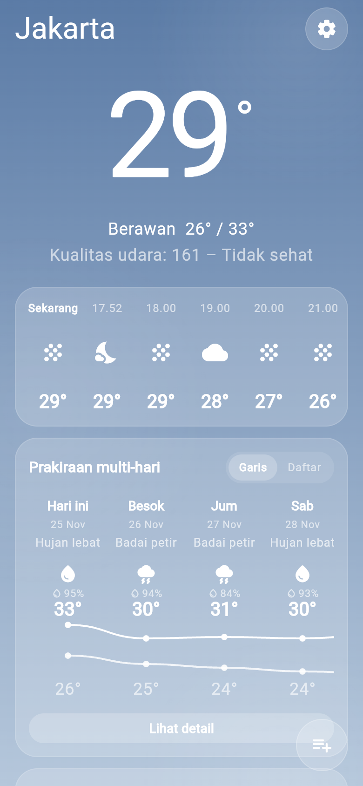
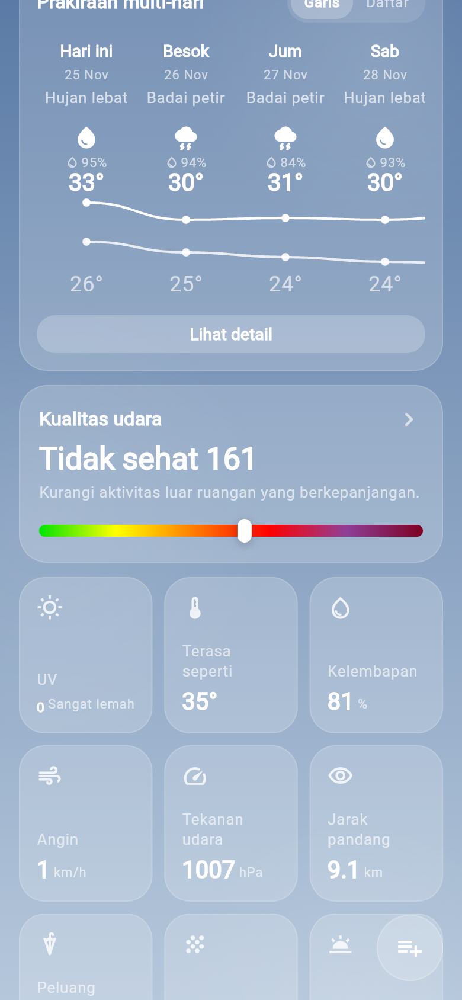

# Cuaca — Aplikasi Cuaca Flutter

Aplikasi cuaca Flutter dengan tampilan seperti aplikasi cuaca bawaan ponsel: latar gradien biru yang berubah mengikuti kondisi cuaca, suhu besar di tengah, dan kartu-kartu transparan. Seluruh data cuaca dan hasil pencarian kota diambil dari **Open-Meteo** (tanpa API key).

## Fitur

**Wajib**

- **Weather Screen** — nama kota, kondisi, suhu saat ini, suhu terendah/tertinggi, kelembapan, angin, tekanan udara, jarak pandang, peluang hujan, curah hujan, serta prakiraan 7 hari.
- **Search Screen** — pencarian kota lewat Open-Meteo Geocoding API (debounce 500 ms, minimal 2 karakter), pilih hasil untuk mengganti lokasi.
- **Favorit, riwayat, dan lokasi terakhir** disimpan di `shared_preferences` dan tetap ada setelah aplikasi ditutup/dibuka kembali.
- **State loading, empty, dan error** dengan tombol **Coba lagi**; error koneksi ditampilkan dalam bahasa Indonesia.
- **Pull-to-refresh** untuk memuat ulang data cuaca.
- **Material 3** dengan `ThemeData` + `TextTheme` terpusat, layout responsif (diuji pada 360×640, 390×844, dan tablet).

**Bonus**

- Kartu **kualitas udara (US AQI)** lengkap dengan kategori, deskripsi, dan bar gradien.
- **Grafik garis** suhu maksimum/minimum 7 hari (`CustomPainter`) dengan mode **Garis / Daftar**.
- Gradien latar berubah sesuai kode cuaca dan siang/malam.
- Kolom matahari terbit/terbenam disisipkan di kartu jam-per-jam.
- Bottom sheet pengaturan (segarkan data, info aplikasi).

## Screenshot

| Weather Screen | Weather Screen (detail) | Search — hasil | Search — favorit |
|---|---|---|---|
|  |  |  |  |

Screenshot lain: [cuaca malam](docs/screenshots/weather-night.png) · [riwayat pencarian](docs/screenshots/search-history.png) · [hasil kosong](docs/screenshots/search-empty.png) · [error + Coba lagi](docs/screenshots/weather-error.png) · [persistensi setelah reload](docs/screenshots/search-persistence.png) · [layout 360×640](docs/screenshots/layout-360.png) · [pengaturan](docs/screenshots/settings.png) · [detail 7 hari](docs/screenshots/forecast-detail.png) · [mode daftar](docs/screenshots/forecast-list.png).

## Video Penjelasan

Demo aplikasi dan penjelasan kode (5–8 menit):

[](https://youtu.be/yfPnSozQNIg)

**Link:** [https://youtu.be/yfPnSozQNIg](https://youtu.be/yfPnSozQNIg)

## Teknologi

- Flutter + Dart, Material 3
- `provider` (`ChangeNotifier`) untuk state management
- `http` untuk GET request dan parsing JSON manual
- `shared_preferences` untuk local storage
- `intl` untuk format tanggal/jam bahasa Indonesia
- [Open-Meteo Forecast](https://open-meteo.com/en/docs), [Geocoding](https://open-meteo.com/en/docs/geocoding-api), dan [Air Quality](https://open-meteo.com/en/docs/air-quality-api)

## Menjalankan

```bash
flutter pub get
flutter run -d chrome     # pratinjau cepat di browser
flutter run               # perangkat/emulator Android
```

Build APK release:

```bash
flutter build apk --release
```

APK dihasilkan di `build/app/outputs/flutter-apk/app-release.apk`. Permission `android.permission.INTERNET` sudah ditambahkan agar data tetap muncul di build release.

## Pengujian

```bash
flutter analyze
flutter test
```

Saat ini `flutter analyze` bersih dan 28 unit/widget test lulus (parsing JSON, model, mapper kode cuaca, gradien, AQI, penyimpanan lokal, ViewModel cuaca/favorit, serta regresi state pencarian).

## Struktur Folder

```
lib/
├─ main.dart                 # runApp + MultiProvider (dependency injection)
├─ app.dart                  # MaterialApp + tema
├─ core/                     # konstanta, tema, mapper, AQI, error, helper JSON
├─ data/
│  ├─ models/                # Location, CurrentWeather, HourlyForecast, DailyForecast, WeatherData, AirQuality
│  ├─ services/              # HTTP client/service + SharedPreferences
│  └─ repositories/          # WeatherRepository, LocationRepository
├─ viewmodels/               # WeatherViewModel, SearchViewModel, FavoritesViewModel
└─ views/
   ├─ screens/               # WeatherScreen, SearchScreen
   └─ widgets/               # kartu kaca, hero suhu, grafik, grid detail, state view
```

Penjelasan arsitektur, alur data, API, dan local storage ada di [docs/DOCUMENTATION.md](docs/DOCUMENTATION.md).

## Catatan

- Data cuaca **tidak di-hardcode**; kota default (Jakarta) hanya dipakai saat belum ada lokasi tersimpan.
- Pencarian selalu memanggil endpoint geocoding, bukan filter data lokal.
- AQI bersifat bonus: jika endpoint kualitas udara gagal, layar cuaca tetap tampil tanpa kartu AQI.
- Proyek ini menyertakan target web untuk keperluan pratinjau/screenshot; target utama tugas adalah Android.
